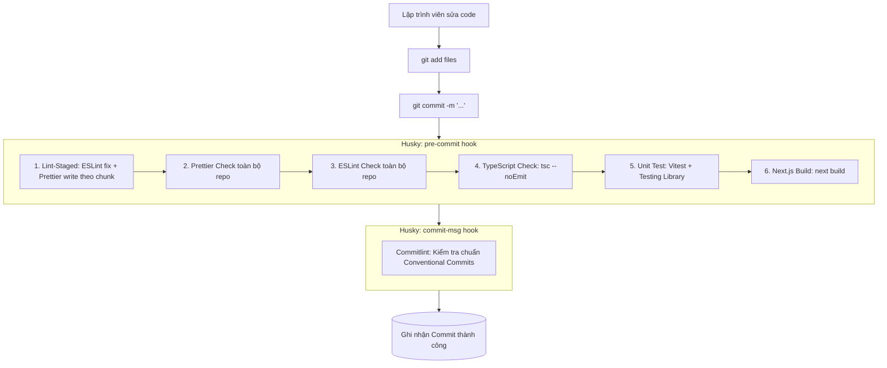

# Next.js Code Quality Toolchain (Linter, Formatter, Git Hooks & Testing)

Bộ công cụ tiêu chuẩn doanh nghiệp (Enterprise-Grade) nhằm đảm bảo mã nguồn trong các dự án Next.js luôn sạch, nhất quán, không lỗi type, không vỡ build và tuân thủ nghiêm ngặt quy ước commit quốc tế.

---

## 🏗️ Tổng quan kiến trúc & Luồng kiểm soát (Quality Pipeline)

Mọi thay đổi mã nguồn phải vượt qua các vòng kiểm tra tự động trước khi được ghi nhận vào Git:



> [!IMPORTANT]
> **Quy tắc bất khả xâm phạm:** Tuyệt đối **KHÔNG** sử dụng cờ `--no-verify` hoặc `-n` khi thực hiện `git commit`. Toàn bộ hooks phải chạy thành công 100% để bảo vệ nhánh Git khỏi mã nguồn lỗi.

---

## 📦 Danh sách Dependencies & Lệnh cài đặt

Chạy lệnh cài đặt toàn bộ devDependencies cần thiết với `pnpm` (hoặc `npm`/`yarn` tương ứng):

```bash
# 1. ESLint & Các Plugins sắp xếp code, Tailwind, Prettier
pnpm add -D eslint @types/node @types/react @types/react-dom eslint-config-next \
  eslint-config-prettier eslint-plugin-prettier \
  eslint-plugin-simple-import-sort \
  eslint-plugin-sort-destructure-keys \
  eslint-plugin-sort-keys \
  eslint-plugin-typescript-sort-keys \
  eslint-plugin-tailwindcss

# 2. Prettier
pnpm add -D prettier

# 3. Git Hooks & Lint-Staged & Commitlint
pnpm add -D husky lint-staged @commitlint/cli @commitlint/config-conventional

# 4. Testing Library & Vitest (Môi trường test hiện đại cho Next.js + React 19)
pnpm add -D vitest @vitejs/plugin-react jsdom \
  @testing-library/react @testing-library/jest-dom @testing-library/user-event
```

---

## ⚙️ Chi tiết cấu hình từng thành phần

### 1. ESLint 9 Flat Config (`eslint.config.mjs`)

Next.js 15+ sử dụng chuẩn cấu hình Flat Config (`eslint.config.mjs`). Cấu hình này tích hợp kiểm tra quy tắc React, Accessibility (a11y), tự động sắp xếp imports, keys, types, và cấm triệt để `console.log` sót lại trong production.

Tạo file `eslint.config.mjs` tại thư mục gốc:

```javascript
/* eslint-disable simple-import-sort/imports */
import nextVitals from 'eslint-config-next/core-web-vitals';
import nextTs from 'eslint-config-next/typescript';
import prettierConfig from 'eslint-config-prettier';
import { defineConfig, globalIgnores } from 'eslint/config';

// Plugins
import prettierPlugin from 'eslint-plugin-prettier';
import simpleImportSortPlugin from 'eslint-plugin-simple-import-sort';
import sortDestructureKeysPlugin from 'eslint-plugin-sort-destructure-keys';
import sortKeysPlugin from 'eslint-plugin-sort-keys';
import tailwindPlugin from 'eslint-plugin-tailwindcss';
import typescriptSortKeysPlugin from 'eslint-plugin-typescript-sort-keys';

const customConfig = {
  plugins: {
    ...nextVitals[0].plugins,
    prettier: prettierPlugin,
    'simple-import-sort': simpleImportSortPlugin,
    'sort-destructure-keys': sortDestructureKeysPlugin,
    'sort-keys': sortKeysPlugin,
    tailwindcss: tailwindPlugin,
    'typescript-sort-keys': typescriptSortKeysPlugin,
  },
  rules: {
    // --- 1. Stylistic & ES6 ---
    'array-bracket-spacing': 'error',
    'array-callback-return': 'off',
    'computed-property-spacing': ['error', 'never'],
    curly: 'error',
    'dot-notation': 'error',
    'no-else-return': 'error',
    'no-floating-decimal': 'error',
    'no-lonely-if': 'error',
    'no-sequences': 'error',
    'no-unneeded-ternary': 'error',
    'one-var-declaration-per-line': 'error',
    'prefer-const': 'error',
    quotes: ['error', 'single', { allowTemplateLiterals: false, avoidEscape: true }],

    // Spacing giữa các khối khai báo
    'padding-line-between-statements': [
      'error',
      { blankLine: 'always', next: 'return', prev: '*' },
      { blankLine: 'always', next: '*', prev: ['const', 'let', 'var'] },
      { blankLine: 'any', next: ['const', 'let', 'var'], prev: ['const', 'let', 'var'] },
    ],

    // --- 2. Clean Code & Code Size Limit ---
    'no-console': 'error', // Cấm console.log bừa bãi
    'max-lines': ['warn', { max: 400, skipBlankLines: true, skipComments: true }],
    'max-lines-per-function': ['warn', { max: 400, skipBlankLines: true, skipComments: true }],

    // --- 3. Imports & Sorting (Tự động format khi save/lint) ---
    'import/first': 'error',
    'import/newline-after-import': 'error',
    'import/no-duplicates': 'error',
    'import/no-named-as-default': 'off',
    'import/no-named-as-default-member': 'off',
    'import/prefer-default-export': 'off',
    'simple-import-sort/imports': 'error',
    'simple-import-sort/exports': 'error',

    // Sắp xếp object keys & destructuring keys
    'sort-destructure-keys/sort-destructure-keys': [2, { caseSensitive: true }],
    'sort-keys': 'off',
    'sort-keys/sort-keys-fix': ['error', 'asc', { caseSensitive: true, minKeys: 2, natural: false }],

    // TypeScript: Tự động sắp xếp interface & enum
    'typescript-sort-keys/interface': 'error',
    'typescript-sort-keys/string-enum': 'error',

    // --- 4. React & JSX Standards ---
    'react-hooks/rules-of-hooks': 'error',
    'react/jsx-sort-props': [
      'error',
      {
        callbacksLast: true,
        noSortAlphabetically: false,
        reservedFirst: true,
        shorthandFirst: true,
      },
    ],
    'react/jsx-uses-react': 'error',
    'react/jsx-uses-vars': 'error',
    'react/no-unsafe': ['error', { checkAliases: true }],
    'react/self-closing-comp': ['error', { component: true, html: true }],

    // --- 5. Tailwind CSS ---
    'tailwindcss/no-custom-classname': 'off',

    // --- 6. Accessibility (a11y) ---
    'jsx-a11y/click-events-have-key-events': 'warn',
    'jsx-a11y/interactive-supports-focus': 'warn',

    // --- 7. Prettier Reporting ---
    'prettier/prettier': ['error', { endOfLine: 'auto' }],
  },
};

const eslintConfig = defineConfig([
  ...nextVitals,
  ...nextTs,
  customConfig,
  prettierConfig, // Phải đặt cuối cùng để override các quy tắc định dạng trùng lặp
  globalIgnores([
    '.next/**',
    '.open-next/**',
    '.wrangler/**',
    'out/**',
    'build/**',
    'dist/**',
    'next-env.d.ts',
    'node_modules/**',
    '.agents/**',
    'coverage/**',
  ]),
]);

export default eslintConfig;
```

---

### 2. Prettier (`.prettierrc` & `.prettierignore`)

Tạo file `.prettierrc`:

```json
{
  "semi": true,
  "trailingComma": "all",
  "singleQuote": true,
  "printWidth": 80,
  "tabWidth": 2,
  "useTabs": false,
  "endOfLine": "auto"
}
```

Tạo file `.prettierignore`:

```text
node_modules
.next
.open-next
.wrangler
dist
build
out
coverage
pnpm-lock.yaml
package-lock.json
yarn.lock
next-env.d.ts
.agents
```

---

### 3. Lint-Staged (`lint-staged.config.mjs`)

> [!WARNING]
> **Windows Command Line Limit (8191 ký tự):**
> Khi số lượng file staged lớn, việc truyền toàn bộ tên file vào một câu lệnh đơn lẻ (`eslint --fix file1 file2...`) sẽ làm sập terminal Windows với lỗi `The command line is too long`.
> Giải pháp chuẩn là áp dụng cơ chế **Chunking (chia batch tối đa 10 files)**.

Tạo file `lint-staged.config.mjs`:

```javascript
// Chunked lint-staged config to avoid Windows "command line too long" error.
// Each task receives files in small batches to stay within the 8191-char limit.

const CHUNK_SIZE = 10;

function chunk(files) {
  const chunks = [];
  for (let i = 0; i < files.length; i += CHUNK_SIZE) {
    chunks.push(files.slice(i, i + CHUNK_SIZE));
  }
  return chunks;
}

function eslintFix(files) {
  return chunk(files).map(
    (batch) => `eslint --fix ${batch.map((f) => `"${f}"`).join(' ')}`,
  );
}

function prettierWrite(files) {
  return chunk(files).map(
    (batch) => `prettier --write ${batch.map((f) => `"${f}"`).join(' ')}`,
  );
}

const lintStagedConfig = {
  '*.{js,jsx,ts,tsx}': (files) => [
    ...eslintFix(files),
    ...prettierWrite(files),
  ],
  '*.{json,md,css,scss}': (files) => prettierWrite(files),
};

export default lintStagedConfig;
```

---

### 4. Commitlint (`commitlint.config.js`)

Quy định cấu trúc commit theo chuẩn quốc tế **Conventional Commits**:
`<type>(<scope>): <subject>`

Tạo file `commitlint.config.js`:

```javascript
module.exports = {
  extends: ['@commitlint/config-conventional'],
  rules: {
    'type-enum': [
      2,
      'always',
      [
        'feat',     // Tính năng mới
        'fix',      // Sửa lỗi
        'docs',     // Thay đổi tài liệu
        'style',    // Format, khoảng trắng, dấu chấm phẩy (không đổi logic)
        'refactor', // Tái cấu trúc mã nguồn (không thêm tính năng, không sửa bug)
        'perf',     // Cải thiện hiệu năng
        'test',     // Thêm hoặc sửa test
        'build',    // Thay đổi hệ thống build, dependencies (npm/pnpm)
        'ci',       // Thay đổi file cấu hình CI/CD (GitHub Actions...)
        'chore',    // Công việc vụn vặt khác
        'revert',   // Revert commit trước
      ],
    ],
    'subject-case': [0], // Cho phép viết hoa/thường tự do trong mô tả
  },
};
```

---

### 5. Husky v9 (`.husky/`)

Khởi tạo Husky:

```bash
pnpm exec husky init
```

#### Hook 1: Kiểm tra nội dung commit (`.husky/commit-msg`)

Tạo hoặc cập nhật `.husky/commit-msg`:

```bash
npx --no -- commitlint --edit "${1}"
```

#### Hook 2: Bộ lọc kiểm thử toàn diện trước commit (`.husky/pre-commit`)

Tạo hoặc cập nhật `.husky/pre-commit`:

```bash
#!/usr/bin/env sh
. "$(dirname -- "$0")/_/husky.sh"

echo '🚀 [1/6] Running lint-staged on staged files...'
pnpm lint-staged

echo '🔍 [2/6] Checking Prettier format across project...'
pnpm check-format || {
  echo '❌ Prettier check failed! Run "pnpm format" to fix formatting.'
  exit 1
}

echo '🔍 [3/6] Checking ESLint rules across project...'
pnpm check-lint || {
  echo '❌ ESLint check failed! Run "pnpm fix-lint" or fix errors manually.'
  exit 1
}

echo '🔍 [4/6] Checking TypeScript types (tsc --noEmit)...'
pnpm check-types || {
  echo '❌ TypeScript typecheck failed! Fix type errors before committing.'
  exit 1
}

echo '🧪 [5/6] Running Unit Tests (Vitest)...'
pnpm test || {
  echo '❌ Unit tests failed! Fix test assertions before committing.'
  exit 1
}

echo '🏗️ [6/6] Verifying Next.js build integrity...'
pnpm build || {
  echo '❌ Next.js build failed! Ensure your code builds cleanly before committing.'
  exit 1
}

echo '✅ All quality checks passed! Proceeding to commit.'
```

*(Trên Linux/macOS, đảm bảo cấp quyền thực thi: `chmod +x .husky/commit-msg .husky/pre-commit`)*.

---

### 6. Testing Toolchain (Vitest + React Testing Library)

Next.js App Router và React 19 tương thích tối ưu nhất với **Vitest** (hỗ trợ native ESM, nhanh hơn Jest gấp nhiều lần, đồng bộ cấu hình alias dễ dàng).

#### File cấu hình `vitest.config.mts`:

Tạo file `vitest.config.mts` ở thư mục gốc:

```typescript
import path from 'node:path';
import react from '@vitejs/plugin-react';
import { defineConfig } from 'vitest/config';

export default defineConfig({
  plugins: [react()],
  test: {
    environment: 'jsdom',
    globals: true,
    setupFiles: ['./vitest.setup.ts'],
    alias: {
      '@': path.resolve(__dirname, './src'),
    },
    coverage: {
      provider: 'v8',
      reporter: ['text', 'json', 'html'],
    },
  },
});
```

#### File khởi tạo môi trường test `vitest.setup.ts`:

Tạo file `vitest.setup.ts` ở thư mục gốc:

```typescript
import '@testing-library/jest-dom/vitest';
```

#### Ví dụ viết Unit Test chuẩn (`src/components/ui/button.test.tsx`):

```tsx
import { render, screen } from '@testing-library/react';
import userEvent from '@testing-library/user-event';
import { describe, expect, it, vi } from 'vitest';

// Giả sử component Button nhận onClick và children
function Button({ children, onClick }: { children: React.ReactNode; onClick?: () => void }) {
  return <button onClick={onClick} type="button">{children}</button>;
}

describe('Button component', () => {
  it('renders correctly with given text', () => {
    render(<Button>Click me</Button>);
    expect(screen.getByRole('button', { name: /click me/i })).toBeInTheDocument();
  });

  it('triggers onClick handler when clicked', async () => {
    const handleClick = vi.fn();
    const user = userEvent.setup();

    render(<Button onClick={handleClick}>Submit</Button>);
    await user.click(screen.getByRole('button', { name: /submit/i }));

    expect(handleClick).toHaveBeenCalledTimes(1);
  });
});
```

---

### 7. Thiết lập Scripts trong `package.json`

Cập nhật phần `"scripts"` trong `package.json` để đồng bộ toàn bộ câu lệnh:

```json
{
  "scripts": {
    "dev": "next dev",
    "build": "next build",
    "start": "next start",
    "prepare": "husky",
    "lint": "eslint",
    "fix-lint": "eslint . --fix",
    "check-lint": "pnpm lint",
    "format": "prettier . --write --ignore-unknown",
    "check-format": "prettier . --check",
    "check-types": "tsc --pretty --noEmit",
    "lint-staged": "lint-staged --config lint-staged.config.mjs",
    "test": "vitest run",
    "test:watch": "vitest",
    "test:coverage": "vitest run --coverage",
    "test-all": "pnpm check-format && pnpm check-lint && pnpm check-types && pnpm test && pnpm build"
  }
}
```

---

## 📋 Hướng dẫn Setup nhanh từng bước cho dự án mới (Runbook)

Khi khởi tạo một dự án Next.js mới hoặc áp dụng cho dự án hiện có, thực hiện theo thứ tự 5 bước:

1. **Bước 1: Cài packages**
   ```bash
   pnpm add -D eslint @types/node @types/react @types/react-dom eslint-config-next eslint-config-prettier eslint-plugin-prettier eslint-plugin-simple-import-sort eslint-plugin-sort-destructure-keys eslint-plugin-sort-keys eslint-plugin-typescript-sort-keys eslint-plugin-tailwindcss prettier husky lint-staged @commitlint/cli @commitlint/config-conventional vitest @vitejs/plugin-react jsdom @testing-library/react @testing-library/jest-dom @testing-library/user-event
   ```

2. **Bước 2: Tạo các file cấu hình**
   - Tạo `eslint.config.mjs`
   - Tạo `.prettierrc` & `.prettierignore`
   - Tạo `lint-staged.config.mjs`
   - Tạo `commitlint.config.js`
   - Tạo `vitest.config.mts` & `vitest.setup.ts`

3. **Bước 3: Khởi tạo Husky**
   ```bash
   pnpm exec husky init
   ```
   - Điền script vào `.husky/commit-msg`
   - Điền script vào `.husky/pre-commit`

4. **Bước 4: Cập nhật `package.json`**
   - Bổ sung các scripts `lint`, `fix-lint`, `check-lint`, `format`, `check-format`, `check-types`, `test`, `test-all`.

5. **Bước 5: Chạy thử toàn diện (Verification)**
   ```bash
   pnpm test-all
   ```
   Nếu tất cả đều xanh (passed), hệ thống kiểm soát chất lượng đã sẵn sàng!

---

## 🛠️ Xử lý lỗi thường gặp (Troubleshooting)

| Vấn đề | Nguyên nhân | Cách khắc phục |
| :--- | :--- | :--- |
| **`The command line is too long`** (Windows) | Staged files quá nhiều vượt quá giới hạn 8191 ký tự của shell Windows. | Luôn dùng `lint-staged.config.mjs` có hàm `chunk()` chia nhỏ 10 files/lệnh. |
| **Commitlint báo `type-empty` hoặc sai format** | Viết commit message tự do không có tiền tố Conventional Commits. | Đổi định dạng commit thành `feat: ...`, `fix: ...`, `chore: ...`. |
| **Xung đột ESLint và Prettier** | Một số rule định dạng (dấu phẩy, quotes) bị cả 2 bên can thiệp. | Đảm bảo `prettierConfig` (`eslint-config-prettier`) nằm ở vị trí **cuối cùng** trong mảng `defineConfig` của `eslint.config.mjs`. |
| **Husky hook không chạy trên macOS / Linux** | File `.husky/pre-commit` thiếu quyền thực thi. | Chạy `chmod +x .husky/*`. |
| **Lỗi Alias `@/...` trong Vitest** | Vitest không tự động map alias từ `tsconfig.json`. | Đảm bảo khai báo `alias: { '@': path.resolve(__dirname, './src') }` trong `vitest.config.mts`. |
| **Lỗi `next-env.d.ts` bị can thiệp** | Linter/formatter thay đổi nội dung file do Next.js tự sinh. | Thêm `next-env.d.ts` vào `globalIgnores` của ESLint và `.prettierignore`. |
